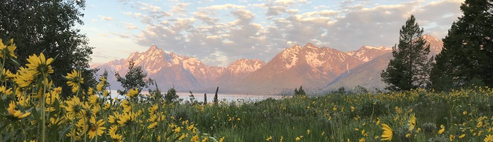

# Laughlin Research Lab website

Live site: https://daniellaughlin.github.io

A plain HTML/CSS site hosted free on GitHub Pages. There is no build step: what's in this
repository is exactly what visitors see.

---

## How to make a change

1. Open the file on GitHub and click the **pencil icon** (Edit).
2. Make your change. Use **Cmd + F** in the browser to find the spot.
3. Click **Commit changes**.
4. Wait 1–2 minutes, then refresh the site (**Cmd + Shift + R** to skip the browser's saved copy).

To edit many files at once (for example, a search-and-replace across every page), press the
**.** (period) key on the repository's main page to open GitHub's built-in editor.

To replace files with new versions from your computer: **Add file → Upload files**, drag them in,
and commit. Files with the same name are overwritten; nothing else is touched.

---

## What's where

| File | Page |
|---|---|
| `index.html` | Welcome (mission, Daniel's titles, *Plant Strategies* recordings) |
| `people.html` | People (current and former lab members) |
| `publications.html` | Publications (books, Letter to a Young Ecologist, articles by year) |
| `research.html` | Research (seminar, funded and former projects, funder logos) |
| `teaching.html` | Teaching |
| `software.html` | Software |
| `lab-openings.html` | Lab openings |
| `global-vegetation-project.html` | Global Vegetation Project |
| `site.js` | The menu, header, and footer shared by every page |
| `style.css` | Colors, fonts, and layout for every page |
| `images/` | Photos, banners, logos, book covers, favicon |
| `audio/` | *Plant Strategies* chapter summaries and the Letter recording (.m4a) |
| `.nojekyll` | Empty file that tells GitHub to publish the files as-is. Don't delete it. |

---

## Common edits

Copy an existing block, paste it where you want the new one, and change the words.
Keep the tags (the parts in `< >`) exactly as they are.

### Add a publication (`publications.html`)

Find the right year and copy any line inside its list:

```html
<li>Smith, A., and <b>D.C. Laughlin</b>. 2026. <a href="https://doi.org/10.xxxx/xxxxx">Paper title</a>. <em>Journal Name</em> 12: 1-10.</li>
```

- `<b>…</b>` makes text bold (use it for your name).
- `<em>…</em>` makes text italic (journals, species names).
- `<a href="LINK">…</a>` makes a link.

The search box and article count update on their own.

**New year:** copy a whole year block, from `<section class="year-block" id="y2026">` down to its
`</section>`, paste it above the newest year, and change both `2026`s. Also add the year to the
"jump to year" links near the top: `<a href="#y2027">2027</a>`.

### Add a current lab member (`people.html`)

1. Upload their photo to `images/`.
2. Copy one member block and edit it:

```html
<li class="member">
  
  <h3>First Last</h3>
  <p class="role">PhD student</p>
  <p>Short project title</p>
</li>
```

Spaces in filenames must be written as `%20` in links (`First Last.jpg` → `First%20Last.jpg`),
or name files without spaces (`First-Last.jpg`) to avoid this.

### Move someone to former lab members (`people.html`)

Delete their member block, then copy one of the `<div class="alum">` blocks under
"Former lab members" and fill in their name, degree, and papers.

### Add a research project (`research.html`)

Copy an `<article class="project">` block under "Funded projects" and edit the title, funder,
team, and description. Set the logo with the `funder-logo` image line, using one of the logos
in `images/` (`nsf-logo.jpg`, `USDA.png`, `NPS_16.webp`, `usfs-rmrs_logo.png`,
`MarsdenFund.png`, `mbie%20logo.png`). When a project ends, cut its block and paste it under
"Former funded projects."

### Post or remove a lab opening (`lab-openings.html`)

Replace the "No positions are posted right now." line under Graduate or Undergraduate students
with the posting text, using `<p>…</p>` around each paragraph.

### Add a course (`teaching.html`)

Copy one `<li class="course">` block and change the name, code, and term.

### Change a banner photo

Each page has one line near the top:

```html

```

Change the filename to any image in `images/`. Wide, short photos work best
(roughly 4–6 times wider than tall).

### Change the menu

Edit the `MENU` list at the top of `site.js`. Each line is one menu item:
`{ label: "Teaching", href: "teaching.html" },`. To add a page, copy an existing `.html`
file, rename it, change its content, and add a line here.

### Change the colors

At the top of `style.css`, under `:root`, change `--accent` (links and highlights) or
`--paper` (background). The site is set to always use dark mode.

---

## Images and audio

- Filenames are **case-sensitive**: `Photo.JPG`, `photo.jpg`, and `photo.jpeg` are three
  different files. A broken image is almost always a filename mismatch.
- GitHub warns on files over 50 MB and rejects files over 100 MB. Convert `.wav` audio to
  `.m4a` first. On a Mac, in Terminal, inside the folder of `.wav` files:
  ```
  for f in *.wav; do afconvert -f m4af -d aac -b 128000 "$f" "${f%.wav}.m4a"; done
  ```
- Resize very large photos (over ~2 MB) before uploading so pages load quickly. On a Mac:
  open in Preview → **Tools → Adjust Size** → width about 1600 pixels.

---

## Troubleshooting

**Change doesn't appear.** Wait two minutes, then hard-refresh (**Cmd + Shift + R**) or open the
page in a private window. Check the **Actions** tab: the latest run should have a green check.

**Red X in the Actions tab.** Click it and read the failed step. If the workflow is called
"Build and Deploy," it's left over from an earlier template: delete the `.github` folder.
If `.nojekyll` is missing, recreate it with **Add file → Create new file**, name it `.nojekyll`,
leave it empty, and commit.

**404 "File not found."** `index.html` must sit at the top level of the repository, not inside
a folder.

**Page looks unstyled or the menu is missing.** `style.css` or `site.js` was deleted or renamed.
Upload it again.

**Tab icon (oak leaf) not showing.** Browsers, especially Safari, keep old tab icons for days.
Check it in a private window. To force an update everywhere, change `?v=2` to `?v=3` in the
icon lines at the top of each page.

---

## Settings that should stay as they are

- **Settings → Pages → Source:** Deploy from a branch, `main`, `/ (root)`.
- **Repository visibility:** Public (required for free GitHub Pages).
- **Repository name:** `daniellaughlin.github.io` (gives the short web address).

### Using plant-traits.net instead

Under **Settings → Pages → Custom domain**, enter `plant-traits.net` and save. Then update the
DNS records at your domain registrar using GitHub's guide, "Managing a custom domain for your
GitHub Pages site." Tick **Enforce HTTPS** once it becomes available.
